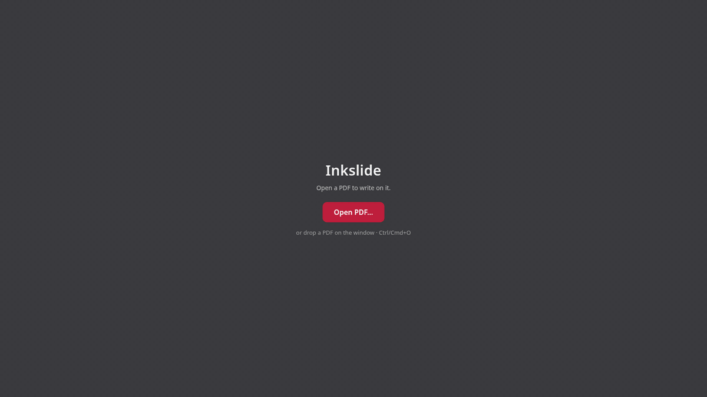

<div align="center">

<picture>
  <source media="(prefers-color-scheme: dark)" srcset="assets/icon/inkslide-dark.svg">
  
</picture>

# Inkslide

**A pen-first PDF annotator for lecture slides.**

</div>



Inkslide shows a PDF one page at a time and lets you write on it with a pen. It is made for
teaching from slides: low-latency pressure-sensitive ink, palm rejection, blank pages to work
things out on, and a compact toolbar you can dock to any edge. Your ink is saved
automatically in a separate notes file; the PDF itself is never modified.

## Features

- **Pen first:** pressure, the eraser end and the side button; touch never draws once a pen
  is seen.
- **Tools:** pen, highlighter, selector (tap, box or lasso), laser pointer, stroke and partial
  eraser, 8 colors, 9 sizes, undo/redo.
- **Pages:** page turns by key or two-finger swipe, pinch zoom and zoom buttons, fit width, blank pages with
  plain, lined or grid paper, an overview of all pages.
- **Notes:** autosaved next to the PDF with crash-safe writes, plus a backup on the desktop.
- **Export and print:** an annotated PDF with vector ink; the original text stays selectable.
- **Marp Notes:** the same toolbar and shortcuts as the annotation mode of Marp HTML decks,
  and it opens the notes saved there.

## Platforms

| Platform | App | State |
|---|---|---|
| Linux | Electron | Works; AppImage and RPM |
| Browser | PWA | Works; installable and offline |
| Windows, macOS | Electron | Builds published, not yet tested much |
| iPad, Android | PWA, Tauri 2 | Builds, not yet tested on a device |

## Install

Download the AppImage or RPM (Linux), the installer (Windows) or the DMG (macOS) from the
[Releases](https://github.com/ansgomez/inkslide/releases) page. The builds are not code-signed
yet; the release notes say how to open them on Windows and macOS.

The browser app, building from source and the iPad and Android shells are covered in
[docs/INSTALL.md](docs/INSTALL.md).

## Usage

Open a PDF with **Open PDF…** (Ctrl+O), by dropping it on the window, or with "Open With" in
the file manager. It opens ready to write on.

| Key | Action |
|---|---|
| P, H, S, L | Pen, highlighter, select, laser |
| E, Shift+E | Stroke eraser, partial eraser |
| 1–4, [ ] | Size S, M, L, XL; thinner, thicker |
| Ctrl+Z, Ctrl+Shift+Z | Undo, redo |
| ← → | Previous, next page |
| G, a number, Enter | Go to that page (G, Enter: overview) |
| W | Fit width |
| Ctrl+=, Ctrl+− | Zoom in, out |
| B | Insert a blank page |

On macOS, use Cmd instead of Ctrl. The [user guide](docs/USER-GUIDE.md) explains every tool,
key and setting, and where notes are stored.

## Development

```sh
pnpm install
pnpm dev          # web dev server and the desktop app on it
pnpm typecheck
pnpm test
```

[CONTRIBUTING.md](CONTRIBUTING.md) covers the tests, code style and commits.
[docs/ARCHITECTURE.md](docs/ARCHITECTURE.md) describes the packages, and
[docs/ROADMAP.md](docs/ROADMAP.md) lists what is still open.

## License

Inkslide is released under the [MIT License](LICENSE).

Bundled libraries keep their own licenses, listed in
[THIRD_PARTY_NOTICES.md](THIRD_PARTY_NOTICES.md).
